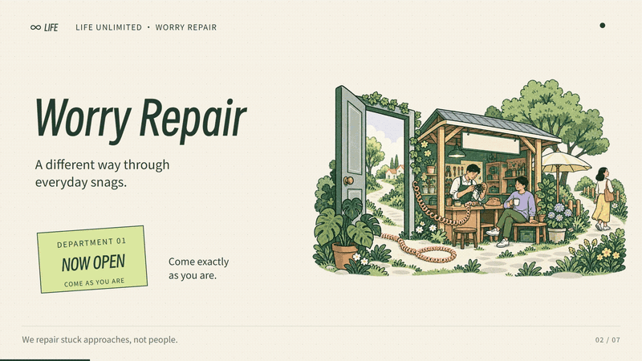
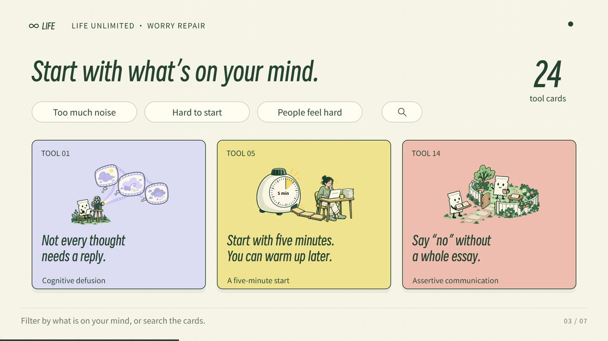
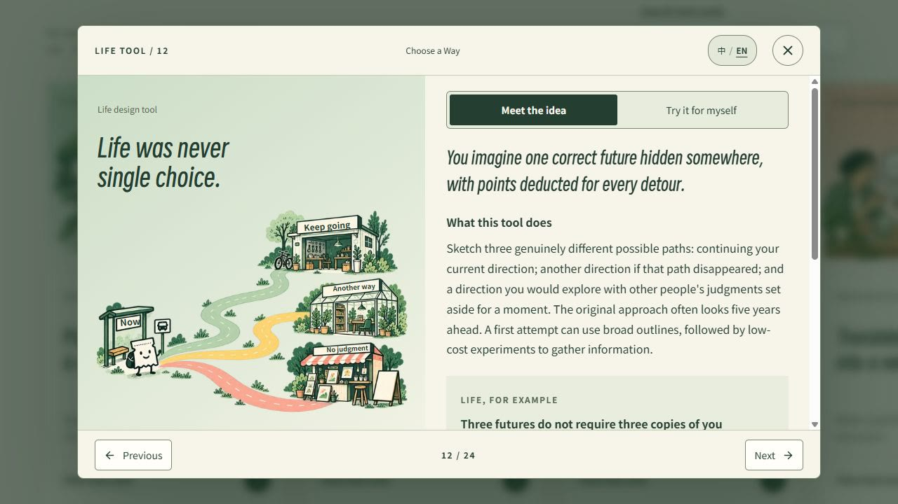

# Worry Repair · LIFE Unlimited

**This began with the people around me.**

My friends, clients and collaborators are actively using AI. As they explore what it makes possible, they are also dealing with pressure from the world around them, the demands of everyday life, and the pace at which AI itself is changing. All of this can leave them feeling anxious, uncertain or unsure where to turn next.

I found myself returning to some of the most basic knowledge and stories about being human. I wanted to turn them into useful resources: things we could read, refer to and bring back into our own lives.

Our time may be finite. With AI and creativity, life can feel full of endless possibilities. Those possibilities also bring difficulties, setbacks, anxiety and questions that take time to work through.

That is why I started Worry Repair. I want to keep gathering the questions about people and life that I, my friends and my clients have encountered, alongside ideas and stories that might help. I hope you find something here that is useful to you.

**[Visit Worry Repair →](https://anxietyfixer.lifeunltdco.com/?lang=en)** · [中文](README.zh-CN.md)

[Watch the full 68-second film](public/media/intro-en-landscape.mp4)

## A cup on the desk. A place to start.

It is after lunch. You put your cup on the desk and open yesterday's note: “Write this down when I have time.” The page is still blank. The afternoon is already filling up.

You find a card about giving an action a recognisable starting point. Beside the idea is an ordinary example:

> If I sit down after lunch and set down my cup, I will write one decision I confirmed today.

You can borrow that sentence or replace it with something from your own life. There is a moment to notice and a small action to try. For today, one line can be enough.

That is what the cards are here for: helping you turn a thought into something you can try when you close the page.

## Bring whatever is on your mind today.

Another day, a conversation may keep replaying in your head. Or you may be looking at two possible futures and struggling to choose. Start with that moment. The full website has 24 cards to help you explore a different way of thinking about it, each with an everyday example and a short practice.

There is no reading order to keep up with. Spend a little time with the card you need, write a next step if it helps, and go back to your day. If you want to return to it, put it in **My Drawer**. Your notes and saved cards stay in this browser.

Some questions need more room. In **Life was never single choice**, you can sketch three possible futures and choose one small way to learn more about them.

## Start a new project at LIFE Unlimited.

Worry Repair is the first open door at LIFE Unlimited. You are welcome to come in and start a “new project” of your own. Begin with an experience, a question or something you are curious about. With [eric-jiangzhishi-skill · Making Sense Together](https://github.com/NewenergyEric/eric-jiangzhishi-skill), you can explore stories worth telling, organise your observations and knowledge about people and life, and shape them into something others can read and share.

I will keep adding to this place: more useful examples, clearer exercises and new ways into familiar problems. Come back when life gets stuck again, or when you have something of your own to share. To hear when something new is ready, choose **Watch → Custom → Releases** at the top of this repository, or add the [release feed](https://github.com/NewenergyEric/worry-repair/releases.atom) to your reader.

**[Try one small step →](https://anxietyfixer.lifeunltdco.com/?lang=en)** · [What's new](https://github.com/NewenergyEric/worry-repair/releases) · [Follow the creator](https://github.com/NewenergyEric)

---

*For contributors:* this repository contains the website code and three bilingual sample cards. Visit the website for the full collection shown in the film. [Run the demo](docs/installation-checklist.md), [help improve it](CONTRIBUTING.md), or read the [maintenance guide](docs/maintenance.md).

Code: [MIT](LICENSE). Content and finished films: [separate terms](CONTENT-LICENSE.md). [Font notices](THIRD-PARTY-NOTICES.md) · [Sharing videos](docs/media.md). PDFs, source files for the full card collection, and editable production projects remain private.

*Everyday reflection and practice; not a substitute for professional diagnosis or treatment.*
