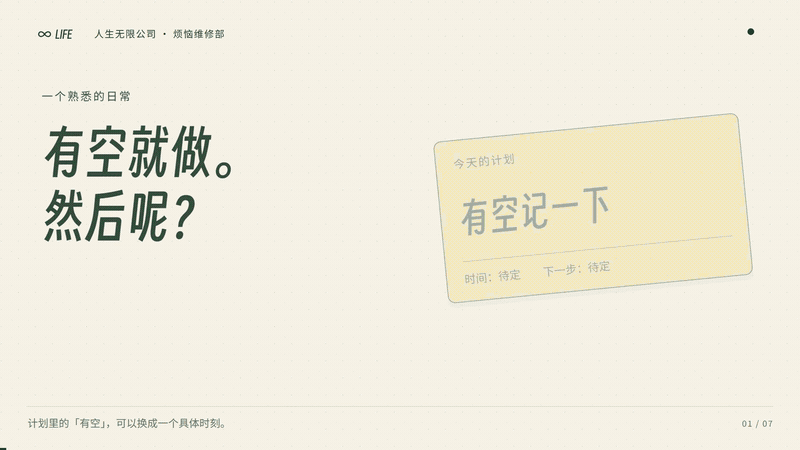
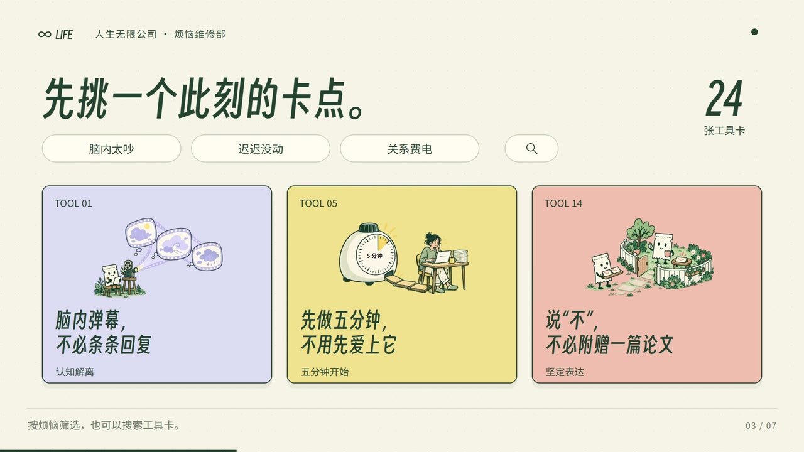
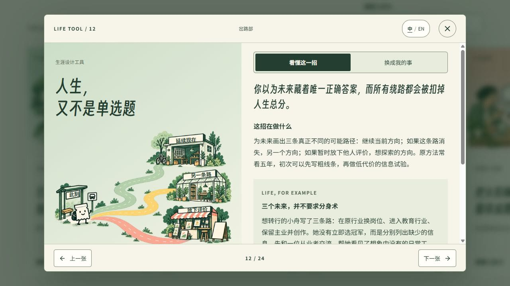

# 烦恼维修部 · 人生无限公司

**这间小店，是从身边的人开始的。**

我的朋友、客户和伙伴们，都在积极使用 AI。在探索新可能的同时，他们也面对着外部的压力、生活的琐事，以及 AI 飞快进化带来的种种困扰。有时是焦虑，有时是疑惑，有时是不知道下一步该往哪里走。

于是，我回到最本初的那些关于人的知识和故事，尝试把它们整理成有益的资料，让我们可以阅读、参考，也能把其中的想法带回自己的生活。

人的一生也许有限，有了 AI 和创造力的加持，人生多了无限的可能。这些可能之中，也有困难、挫折、焦虑和疑惑，需要我们慢慢面对。

烦恼维修部，就是这样开始的。我想把自己、朋友和客户遇到过的关于人与生活的问题，连同可能有帮助的想法和故事，持续整理在这里。希望你来到这里时，能找到一点对自己有用的东西。

**[走进烦恼维修部 →](https://anxietyfixer.lifeunltdco.com/?lang=zh)** · [English](README.md)

[观看完整 68 秒短片](public/media/intro-zh-landscape.mp4)

## 水杯放下了，事情也有了一个开始。

午饭后，你把水杯放回桌上，打开昨天的便签：“有空记一下。”页面还是空的，下午的事情已经排了上来。

你翻到一张卡，讲的是怎样给行动找一个认得出的开始。旁边有一个很日常的例子：

> 如果午饭后坐回工位，放下水杯，我就写一条今天已确认的决定。

你可以借用这句话，也可以换成自己的事。一个能认出来的时刻，接上一个当下做得到的小动作。今天，先写一条也可以。

这些卡片想帮你的，就是把脑子里的一个想法，变成关掉网页之后可以试试的一件事。

## 今天是什么烦恼，就从那里开始。

也许另一天，一段对话总在脑中重播。也许你面前有两条路，想了很久还是选不出来。完整网页里有 24 张工具卡，每张都放着一个想法、一个日常例子和一份小练习，陪你从眼前这件事找起。

不用按顺序读，也没有要赶上的进度。翻一张此刻需要的，愿意的话写下自己的下一步，然后回到生活里。想留下的办法，可以放进“我的抽屉”，下次再来。笔记和收藏只留在当前浏览器。

有些问题，需要先给可能性留点空间。比如“**人生，又不是单选题**”：先画出三条不同的路，再用一个小尝试，多了解一点每条路上的真实生活。

## 来人生无限公司，开展一个“新项目”。

烦恼维修部，是人生无限公司先打开的第一扇门。也欢迎你来到这里，开展自己的“新项目”。从一段经历、一个问题或一份好奇开始，你可以借助 [eric-jiangzhishi-skill · 一起读懂](https://github.com/NewenergyEric/eric-jiangzhishi-skill)，发现值得记录的故事，整理关于人与生活的感知与知识，再把它们变成可以阅读、可以分享给别人的内容。

我会继续给这里添一些东西：更贴近日常的例子、更容易上手的练习，还有面对老烦恼时可以试的新办法。下次卡住时，或者有了自己的故事想分享时，再回来坐坐。想知道这里有什么新变化，可以在仓库顶部选择 **Watch → Custom → Releases**，也可以把[版本订阅](https://github.com/NewenergyEric/worry-repair/releases.atom)放进常用的阅读器。

**[先试一个小办法 →](https://anxietyfixer.lifeunltdco.com/?lang=zh)** · [最近更新](https://github.com/NewenergyEric/worry-repair/releases) · [关注作者](https://github.com/NewenergyEric)

---

*想参与完善这个小地方？* 本仓库开放网站代码与三张双语示例卡，短片里的完整内容可到网页阅读。[运行示例](docs/installation-checklist.md)、[参与贡献](CONTRIBUTING.md)或查看[维护说明](docs/maintenance.md)。

代码采用 [MIT](LICENSE) 许可；内容与视频成片见[独立许可](CONTENT-LICENSE.md)。[字体声明](THIRD-PARTY-NOTICES.md) · [分享视频](docs/media.md)。PDF、完整卡包源文件与可编辑制作工程保持私有。

*用于日常思考与练习，不替代专业诊断与治疗。*
